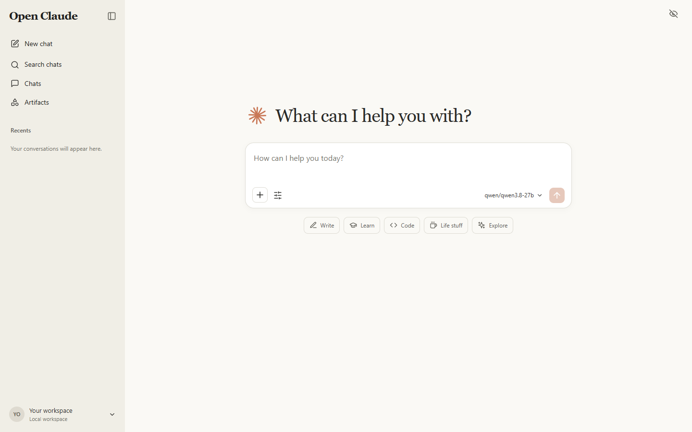
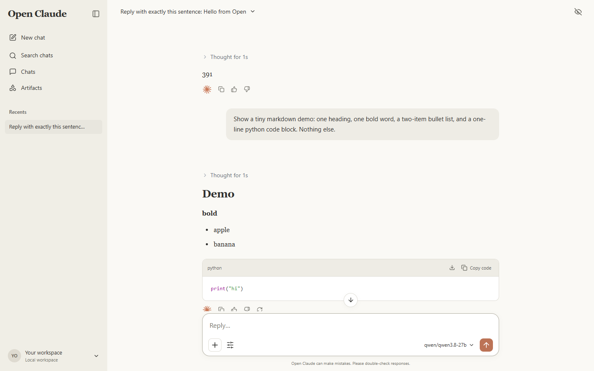
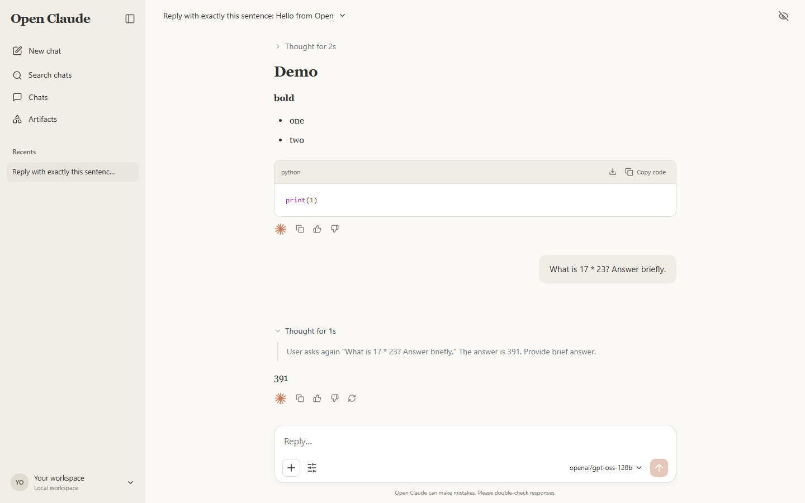
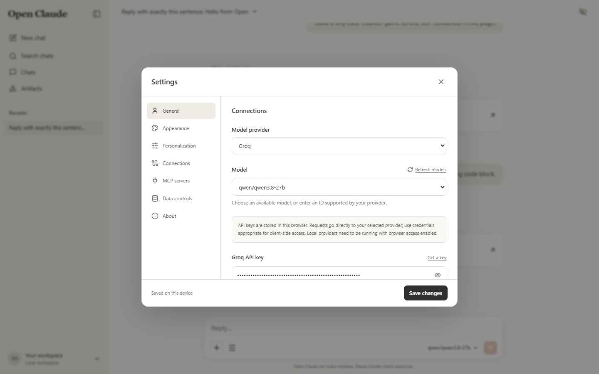
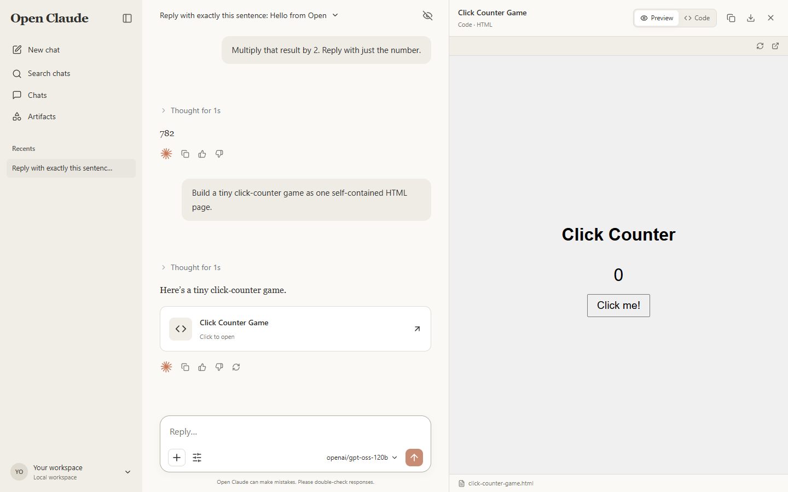
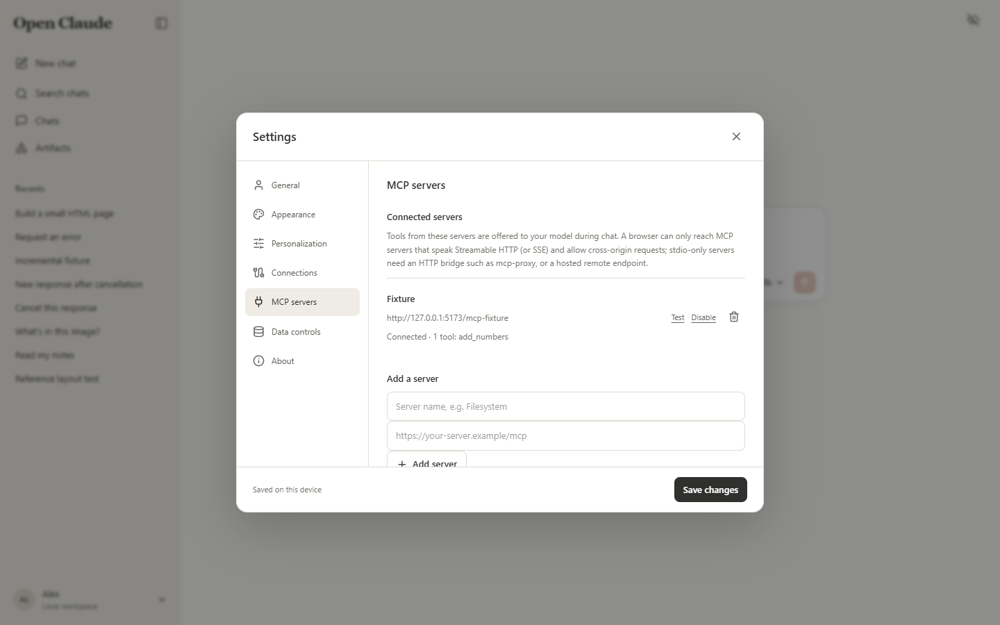

<div align="center">


# Open Claude

**A frontend-only AI chat workspace inspired by the Claude interface.**
Bring your own API keys. No backend, no database, no accounts, no subscriptions.

[](LICENSE)
[](https://react.dev/)
[](https://vitejs.dev/)

</div>

---

Open Claude is an independently written React application that recreates the look and feel of
[claude.ai](https://claude.ai) while talking **directly from your browser** to the model provider you
choose. Every conversation, setting and API key stays in your browser's `localStorage`; nothing is
sent to any server operated by this project, because there is no server.

It is not affiliated with Anthropic. "Claude" and the Claude interface are Anthropic's; this project
is a fan-made, original implementation inspired by it.

## Screenshots

All screenshots below were captured from this repository running against live Groq inference
(November 2026), not mockups.

| Welcome screen | Conversation |
| --- | --- |
| [](screenshots/live-empty.png) | [](screenshots/live-conversation.png) |

| Reasoning, folded like Claude | Provider connections |
| --- | --- |
| [](screenshots/live-thinking.png) | [](screenshots/live-settings.png) |

| Artifacts side panel | MCP servers |
| --- | --- |
| [](screenshots/live-artifact.png) | [](screenshots/desktop-settings-mcp.png) |

## What it does

- **Streaming chat** with a stop button, incremental rendering, and honest error alerts (provider
  failures are shown as errors, never faked as assistant messages).
- **Reasoning display** for models that stream thinking tokens (e.g. Groq's `openai/gpt-oss-*` and
  `qwen/qwen3.8-*`, DeepSeek R1, Anthropic extended thinking). Groq models that hide reasoning at
  the default effort are sent `reasoning_format: parsed` with an explicit effort so their thinking
  actually arrives. While thinking arrives you see a shimmering "Thinking…" row; afterwards it
  folds into a muted "Thought for *n*s" row you can expand.
- **Markdown rendering**: GFM tables, lists, blockquotes, and syntax-highlighted code blocks with
  copy and download buttons.
- **Retry, copy and feedback** actions on responses. Thumbs up/down are stored for the session only
  and are never sent anywhere.
- **Attachments**: images (for vision-capable models) and text-based files, read entirely in the
  browser. Unsupported binary formats are rejected with an explanation instead of being silently
  dropped.
- **Web search and deep-research workflows** powered by your own [Tavily](https://tavily.com) key,
  with inline citations. Trigger a long-form report with a prompt starting `deep research:`.
- **Artifacts** in a Claude-style side panel: title and type header, Preview/Code tabs, copy,
  download, refresh and open-in-new-tab. Detection is a single shared parser, so any model that
  emits a complete HTML/JSX/SVG code block gets a working artifact instead of raw code in chat;
  previews run inside a sandboxed iframe with no access to the app's storage.
- **MCP servers**: connect Streamable HTTP MCP servers in Settings, test them, and their tools are
  offered to the model during chat (OpenAI-compatible providers and Anthropic). Tool results are
  fed back into the conversation automatically, with a live "Using …" status row.
- **Chat history** in `localStorage`: rename, delete, search, switch, JSON export and import.
  Corrupted saved history is preserved, not overwritten, until you import a backup or explicitly
  delete it.
- **Incognito chats** that are never persisted.
- **Light / dark / system themes**, a custom system prompt, and a display name for greetings.
- **Model picker** with search across every connected provider, showing context size and vision
  capability per model.
- **Responsive layout** down to small phones, with a drawer sidebar and bounded menus.

## Providers

Keys are entered in **Settings → Connections** and stored in your browser. Model lists are fetched
live from each provider; the defaults below were verified against the providers' catalogs in
November 2026.

| Provider | Auth | Browser (CORS) access | Default model |
| --- | --- | --- | --- |
| Anthropic (Claude) | API key | Verified | `claude-sonnet-5-5` |
| OpenAI | API key | Verified | `gpt-6-astra` |
| Google Gemini | API key | Verified | `gemini-4-hydrogen` |
| Groq | API key | Verified, **live-tested** | `openai/gpt-oss-120b` |
| OpenRouter | API key | Verified | `openrouter/auto` |
| Mistral AI | API key | Verified | `mistral-large-4` |
| DeepSeek | API key | Verified | `deepseek-flash` |
| xAI (Grok) | API key | Verified | `grok-4.7` |
| Together AI | API key | Verified | `moonshotai/Kimi-K3.1-Pro` |
| Cerebras | API key | Verified | `gpt-oss-120b` |
| Fireworks AI | API key | Verified | `accounts/fireworks/models/deepseek-v4p1-flash-1017` |
| Custom OpenAI-compatible endpoint | Optional key + base URL | Depends on your server | your choice |
| Ollama (local) | none | Requires Ollama running with CORS enabled | `qwen3` |
| LM Studio (local) | none | Requires LM Studio server with CORS enabled | `local-model` |

"Verified" means the provider's CORS preflight was checked from a browser origin and the client is
covered by unit tests. Default model IDs were re-checked against each provider's public catalog or
documentation on 17 November 2026, and retired IDs (`deepseek-chat`, `grok-4`, `gemini-2.5-flash`,
the Llama 3.3 serverless tiers) were replaced. **Only Groq has been exercised end-to-end with live
inference in this repository's browser tests**; the other cloud providers need your own key to try. Anthropic requests
include the `anthropic-dangerous-direct-browser-access` header that Anthropic requires for
client-side calls — use a key you are comfortable exposing to a browser, and rotate it if leaked.

## MCP servers

Open Claude speaks the MCP **Streamable HTTP** transport (JSON-RPC over POST, responses as JSON or
SSE, `Mcp-Session-Id` kept across requests) directly from the browser tab. Add servers in
**Settings → MCP servers**, press **Test** to see the tool list or the exact connection error, and
enable/disable or remove them at any time. Configuration is saved in `localStorage`.

During a chat, every enabled server is connected, its tools are flattened into provider tool
definitions (`server__tool` names), and the model can call them. Results — including tool errors —
are returned to the model for up to five rounds before the final answer is saved.

Honest limits of a backend-free design:

- A browser tab cannot spawn processes, so **stdio-only MCP servers do not work directly**. Bridge
  them to HTTP (e.g. `mcp-proxy`) or use a hosted remote endpoint.
- The server must allow cross-origin browser requests (CORS), including the `Mcp-Session-Id`
  header. The Test button reports failures instead of pretending the server connected.
- Tool calling is implemented for OpenAI-compatible providers and Anthropic. Gemini, Ollama and
  LM Studio clients ignore MCP tools for now.

## Quick start

Requires Node.js 18+.

```bash
npm install
npm run dev
```

Open http://localhost:5173, then:

1. Open **Settings → Connections**.
2. Pick a provider and paste its API key (Groq keys are free at
   [console.groq.com/keys](https://console.groq.com/keys)).
3. Save, choose a model in the composer's model menu, and chat.

For local models, start Ollama (`OLLAMA_ORIGINS=* ollama serve`) or the LM Studio server with CORS
enabled, then select it as the provider — no key needed.

Production build: `npm run build`, then serve `dist/` from any static host.

## Tests

```bash
npm test          # 33 unit tests: stream parsing, tool-call accumulation, MCP client, import safety
npm run test:ui -- <path-to-playwright-core/index.js> <path-to-chrome>
                  # 18 browser groups against intercepted fixtures, incl. a fake MCP server;
                  # no real credentials used
GROQ_API_KEY=... node scripts/live-groq.mjs <path-to-playwright-core/index.js> <path-to-chrome>
                  # 15 live Groq checks: streaming, reasoning, artifacts, retry, multi-turn
GROQ_API_KEY=... node scripts/live-mcp.mjs <path-to-playwright-core/index.js> <path-to-chrome>
                  # 4 live checks: real Groq tool calling against a real local MCP HTTP server
```

The UI suites need an already-installed `playwright-core` and a Chrome/Chromium executable; they
download nothing. The live script reads the key from the environment only and never writes it to
disk or screenshots.

## Privacy and security notes

- API keys, chats and settings live in `localStorage` in plain text. Anyone with access to your
  browser profile can read them. This is inherent to a backend-free design.
- Requests go straight from your browser to the provider you selected. There is no proxy and no
  telemetry.
- Exported chat JSON excludes credentials and internal metadata.
- Artifact previews run in sandboxed iframes (`allow-scripts` only) and cannot reach the app's
  storage or origin.
- If a key is ever exposed (shared screenshot, committed file, pasted chat), rotate it at the
  provider immediately.

## Limitations

- Code/Build editor modes exist in the source but are hidden from the UI until implemented; the
  shipped experience is the chat workspace.
- There is no toggle for Anthropic extended thinking budget; reasoning is shown whenever the
  selected model streams it.
- Provider catalogs change over time. If a default model disappears, pick another in the model
  menu — the list is fetched live.
- Web search and research require a Tavily key; without one the toggle explains what is missing
  instead of pretending to search.
- MCP is limited to HTTP/SSE servers reachable from the browser with CORS; stdio servers need a
  bridge, and non-OpenAI/Anthropic providers ignore MCP tools (see above).

## Project layout

```
src/
  components/   Chat workspace, composer, messages, thinking row, artifacts, settings
  context/      Chat, theme and mode state (localStorage-backed)
  lib/llm/      Provider registry, per-provider clients, model catalog service
  lib/          Search tool, MCP Streamable HTTP client, chat import/export validation, markdown helpers
scripts/        Mocked UI suite, live Groq suite, live MCP suite, asset copy helper
docs/           Claude interface reference notes
```

## License

MIT — see [LICENSE](LICENSE).